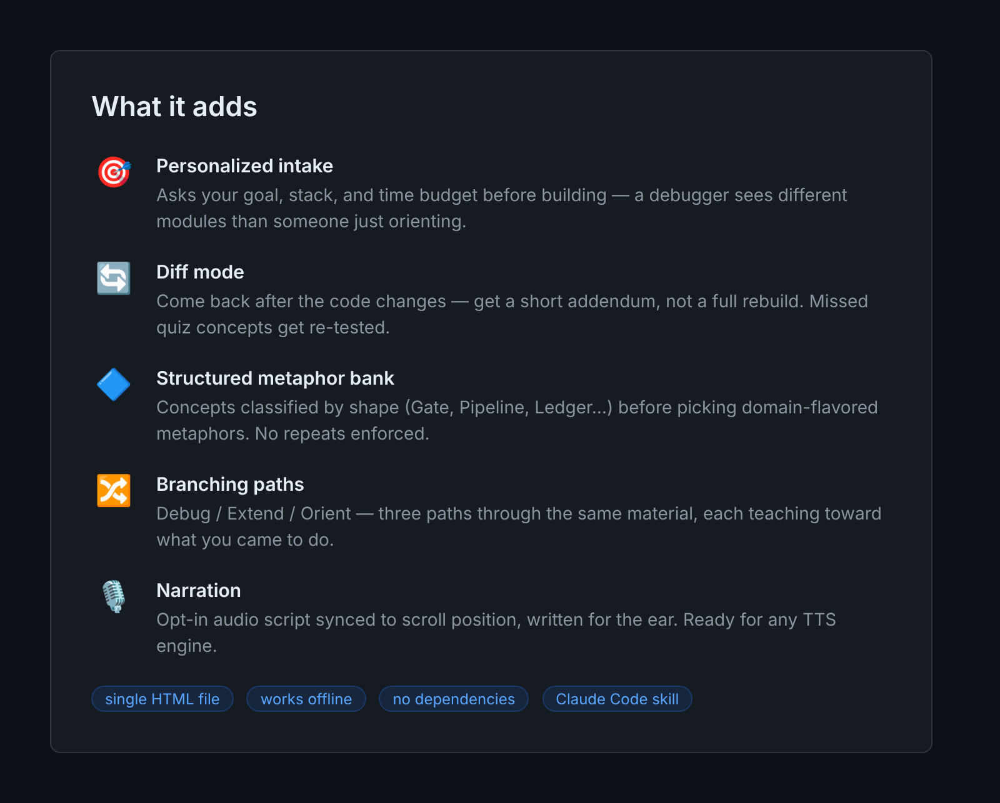
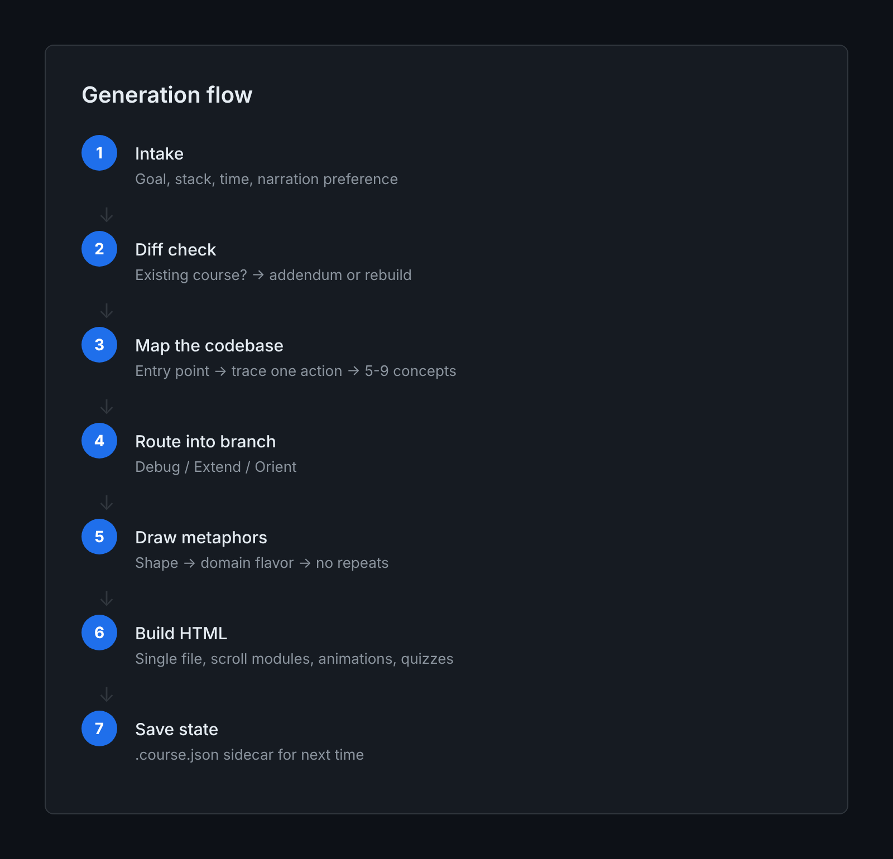
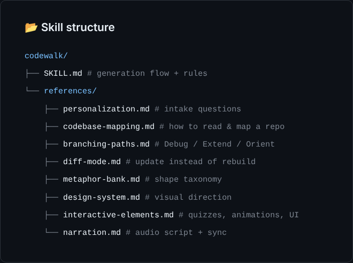

# codewalk

**Turn any codebase into a personal, interactive course — one HTML file, zero dependencies.**

You built something with an AI agent. It works. You don't know *how* it works — and the next time it breaks, you're stuck in a loop asking the agent to fix what it broke.

Codewalk closes that gap. Point it at a repo, tell it what you're trying to do, and get back a single self-contained page that teaches you how the code actually works — with scroll-driven animations, branching paths, real code linked to its source, and quizzes that test whether you *get it*, not whether you memorized it.

<p align="center">
  
</p>

---

## What you get

A single `.course.html` file. Inline CSS, inline JS, no CDN, no build step. Double-click to open. Works offline, on any device.

Inside it: scroll-based modules with a progress bar, code snippets copied verbatim from the repo and linked to the exact line on GitHub, side-by-side code-to-plain-English translations, animated visualizations triggered by scroll (not timers), quizzes with real follow-up questions on wrong answers, a persistent branch switcher (Debug / Extend / Orient), domain-matched visuals instead of the default gradient-and-sans-serif AI look, and a closing section that names what was left out and why.

A `.course.json` sidecar saves state — come back after the code changes and codewalk diffs the repo instead of rebuilding from scratch.

---

## How it works

<p align="center">
  
</p>

Codewalk is a [Claude Code](https://docs.anthropic.com/en/docs/claude-code) skill — structured instructions that guide an agent through generation. It reads your codebase, asks four short questions (goal, stack, time, narration preference), traces one real user action end-to-end, classifies every concept by its underlying shape (Gate, Pipeline, Ledger, Cache, Queue, Boundary, Broadcast, Lookup, Scheduler), picks domain-flavored metaphors with no repeats, and builds the course around your stated intent.

Three paths through every course: **Orient** (understand the system), **Debug** (trace a failure), **Extend** (add a feature). Same concept map, different ordering, depth, and tone. Shared modules render once; switching paths doesn't reset your progress.

---

## Quick start

```bash
# Copy the skill into your Claude Code skills directory
cp -r codewalk/ ~/.claude/skills/

# Open any project and say:
# "Turn this into a course"
# "Walk me through this codebase"
# "Teach me how this code works"
# "I'm debugging X — make me a codewalk"
# "Update my codewalk"  (triggers diff mode)
```

---

## Skill structure

<p align="center">
  
</p>

Eight reference documents, each loaded only when its step in the generation flow calls for it — not front-loaded. `SKILL.md` is the orchestrator; the references are the methodology.

---

## Credit

The core idea — turning a codebase into a single-file interactive HTML course with scroll-based modules, code-to-English translations, animated visualizations, and application-testing quizzes — comes from [codebase-to-course](https://github.com/zarazhangrui/codebase-to-course) by [Zara Zhang](https://x.com/zarazhangrui).

Codewalk is not a fork. It reimplements that idea with five additions: personalized intake, diff mode, a structured metaphor bank, opt-in narration, and branching paths.

---

## License

MIT
